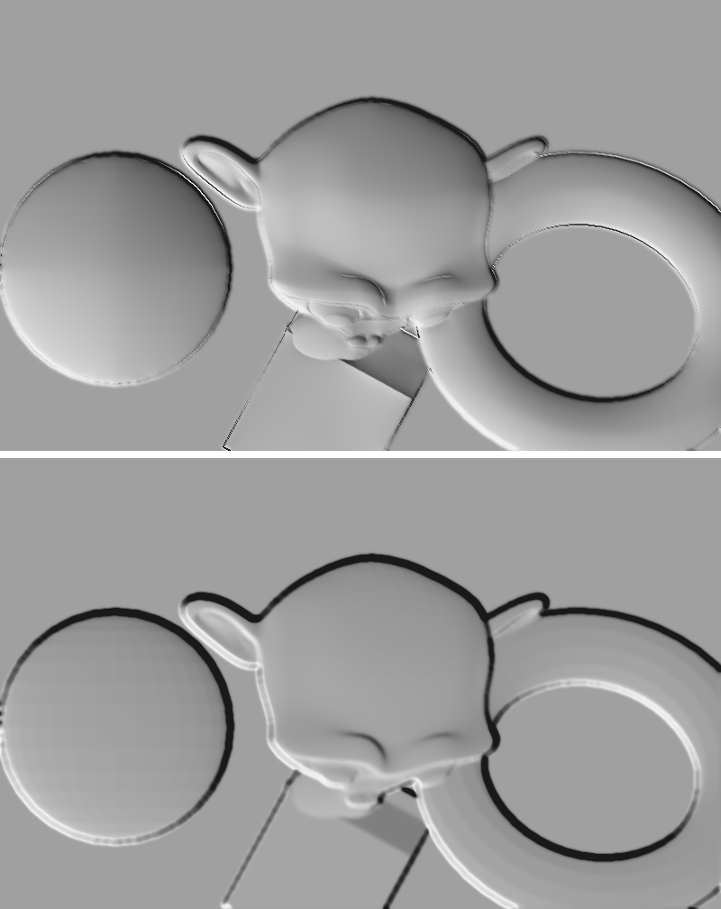
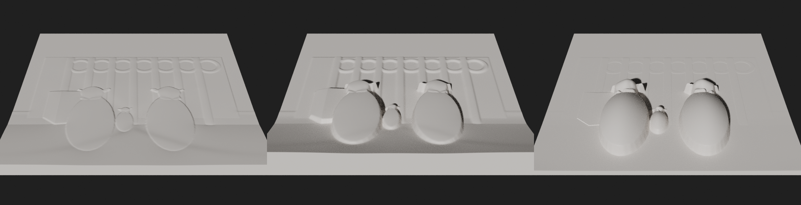

# Bas Relief Generator for Blender

Turns whatever the active camera sees into a printable bas-relief panel, similar to
ZBrush's Bas Relief feature. You set up the scene and the camera, press one button, and
get a watertight mesh at real-world size, ready to export to STL.

## Why it isn't just a depth map

A depth map makes every silhouette a cliff. Each object sticks straight out toward you
and the surface detail gets squashed. This add-on works on surface **slopes**, taken
from the camera-space normal map, so it behaves like a real relief carving:

1. One ray is cast per output pixel from the active camera. The add-on records the depth and the
   *smooth interpolated* normal, which respects shade smooth, auto smooth and custom normals.
2. Occlusion edges (silhouettes, one object in front of another) are detected and their
   depth jumps are removed.
3. Slopes are compressed logarithmically. Steep areas flatten a lot and gentle detail
   barely changes, so all the detail stays readable in a few millimetres.
4. Optional detail boost (unsharp masking in the gradient domain).
5. The slopes are integrated back into a height field with an exact Poisson solve.
6. A controllable, softened amount of depth ordering is blended back in, so objects still
   separate from the background and from each other.

Top: this add-on. Bottom: a plain depth map at the same total depth.

## Install

Blender 4.2 or newer: *Edit → Preferences → Get Extensions → ▾ → Install from Disk…* and pick
`blender_bas_relief.zip`. For Blender 4.1, use *Add-ons → Install…* and pick the same zip.

The panel is in the **3D Viewport sidebar (N) → Relief** tab.

## Workflow

1. Build your scene and add a camera. **Orthographic** gives the truest reliefs. Perspective
   works, but it bakes the perspective into the panel.
2. Set **Output Properties → Resolution**. The aspect ratio becomes the panel shape, and the
   pixel count becomes the mesh density (one vertex per pixel, scaled by the % slider).
   For example, 1500 × 1000 px at 150 mm wide gives 0.1 mm detail.
3. Set the panel width, relief depth and base thickness, then press **Generate Relief**.
4. Adjust the shape settings and press **Rebuild (Reuse Capture)**. This skips the ray casting,
   so it's fast. Press Generate again after you move anything in the scene.
5. Export with *File → Export → STL*. With the default "1 Unit = 1 mm" setting, the numbers in
   the STL are millimetres, which is what slicers expect.

The camera's clip end acts as the background: anything past it, or empty space, becomes the
flat background plate. You can also include a backdrop object.

## Settings

| Setting | What it does |
|---|---|
| Source | Visible objects, selected objects only, or one collection. The generated relief is always ignored. |
| Panel Width | Physical width in mm. The height follows the camera aspect ratio. |
| Relief Depth | Height of the highest point above the background, in mm. |
| Base Thickness | Backing plate thickness, in mm. |
| Units | `1 Unit = 1 mm` (best for STL) or true size in scene units. |
| Presets | Starting points: *Low Relief (Coin)*, *Bas Relief*, *High Relief (Ghiberti)*. |
| **Compression** | How much steep slopes flatten compared with gentle ones, for the **nearest** parts of the scene. 0 = no compression. 3–8 is typical. Higher gives a flatter, more even, more "coin-like" relief. |
| **Far Compression** | The same, for the **farthest** parts. Values in between blend by depth. Set it higher than Compression to keep the foreground round and full while the distance flattens. |
| **Background Flattening** | Shrinks all relief toward the far end, so distant things are almost drawn into the surface (*rilievo schiacciato*). |
| **Detail Boost** | Exaggerates fine surface detail. 1 = unchanged. |
| Detail Size | Pixel size of what counts as "fine" detail for the boost. |
| **Depth Layering** | 0 = pure normal-based relief (edges flush with the background). 1 = plain depth map. 0.15–0.4 is a good range. |
| **Foreground Emphasis** | Shapes Depth Layering. Above 1, the nearest objects get most of the depth and the distance is squeezed. 1 = linear. |
| Background Lift | How far even the farthest object stands off the background. |
| **Edge Softness** | Rounds the silhouette steps (in pixels). This helps printing and looks more hand-carved. |
| Edge Threshold | Slope above which a depth jump counts as an occlusion edge. This also caps slopes. 3 ≈ 72°. |
| Smoothing | Final blur of the height field (in pixels). This removes stair-stepping. |
| Use Smooth Normals | Takes slopes from interpolated normals. Turn it off to use the raw depth buffer. |
| Invert | Intaglio: carves the image into the panel instead of raising it (useful for moulds). |
| **Depth Layers** | Gives collections their own **depth band** (bottom and top, as a fraction of Relief Depth) and their own Compression, Far Compression, Detail Boost and Depth Layering. Each layer is solved separately and placed in its band. Objects in no layer use the global settings and the "Objects in no layer" band. If an object is in several layers, the first one in the list wins. |
| Mesh Step | Uses every Nth pixel as a vertex, to make the mesh lighter. |
| Watertight Solid | Adds sides and a flat back so the mesh is manifold and printable. |
| Heightmap PNG | Optionally also writes a 16-bit grayscale heightmap (for CNC or displacement). |

## High relief / Ghiberti-style panels

Panels like Ghiberti's *Gates of Paradise* mix several kinds of relief in one panel. Foreground
figures are almost in the round, the middle ground is half relief, and the architecture behind
is barely raised. A sculptor plans this as a few depth zones, and **Depth Layers** works the same way:

1. Put your figures in collections, for example `Foreground`, `Midground` and `Background`
   (architecture and landscape).
2. Choose **Presets → High Relief (Ghiberti)**. Turn on **Depth Layers** and add a layer for each
   collection, then set the bands. These are good starting values:

   | Layer | Bottom | Top | Compression | Depth Layering |
   |---|---|---|---|---|
   | Foreground | 0.35 | 1.00 | 1–2 | 0.5 |
   | Midground | 0.12 | 0.38 | 3 | 0.3 |
   | Objects in no layer (architecture) | 0.00 | 0.10 | global (with Background Flattening) | |

3. Use a perspective camera with a moderate lens (35–50 mm). Then the architecture recedes
   in perspective, as it does on the Gates.
4. Set Relief Depth to 12–25 mm on a 150–250 mm panel, and Edge Softness to 3–5 px so the
   foreground steps print cleanly.

Left to right: default settings, the High Relief preset, and the preset with depth layers.

**Limit:** the result is a single height surface seen from the front, so it has no undercuts.
Ghiberti's foreground heads and limbs come completely free of the ground. To get that, generate
the panel with the foreground layer's band kept low. Then add the foreground figures as real
geometry: duplicate them, flatten them toward the camera with a scale along the camera's view
axis, cut off their backs, and boolean-union them onto the panel. Or sculpt the undercuts by
hand in Sculpt Mode on the generated relief.

## Tips

* Go for **more relief depth and higher compression** rather than a deep, uncompressed relief.
  Reliefs read through light and shadow, not real depth.
* Thin parts that sit at different depths, like fingers in front of a body, separate better
  with a bit more Depth Layering and a small Edge Softness.
* Ray casting runs at about 1 M rays per second, plus processing. A few megapixels take
  only a few seconds.
